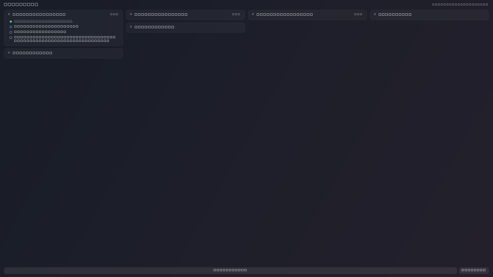

# GetItDone

A lightweight, offline-first project manager that lives on your Windows desktop.
Stories and tasks are painted directly onto the wallpaper area, so your work is
visible the moment you log in — no window to open, no app to switch to.

> **Status: pre-alpha.** Phases 1–2 of the [implementation plan](docs/plan.md) are
> complete (data model, persistence, desktop widget, status workflow). Story and
> task creation/editing, the system tray icon, and Windows auto-start are still
> in progress — see the [implementation plan](docs/plan.md).

---

## Features

- **Desktop-embedded widget** — frameless, always-on-bottom window covering the
  desktop area. Never steals focus from your active application.
- **Story → task hierarchy** — expand a story inline to reveal its tasks.
  One story is expanded at a time to keep the desktop readable.
- **Three-state status workflow** — click a task to advance it:
  `todo` (gray) → `inprogress` (blue) → `close` (green) → `todo`.
- **Adaptive layout** — stories flow into 1–4 columns depending on screen width,
  and re-flow automatically when resolution, DPI, or the taskbar changes.
- **Offline-first** — one human-readable JSON file, autosaved on every change.
- **Crash-resistant storage** — a missing or corrupt file recovers to an empty
  workspace instead of failing at startup; damaged files are quarantined rather
  than deleted, and writes are atomic.

---

## Requirements

- Windows 10/11 (primary target), or Linux with X11/XWayland
- Python 3.10+
- PyQt6

On Linux the widget uses `_NET_WM_WINDOW_TYPE_DESKTOP` to join the desktop
layer, which needs an X11 session (XWayland under GNOME is fine). Native
Wayland cannot position or layer a client window, so the widget degrades to an
ordinary window there. Use `--no-desktop` to force the always-on-bottom
fallback, or `--top` for an ordinary window.

## Install

\\powershell
git clone https://github.com/abhijeetmkumbhar/GetItDone.git
cd GetItDone
python -m venv .venv
.venv\\Scripts\\Activate.ps1
pip install -e ".[dev]"
\\n
Then run it:

\\powershell
python -m getitdone          # your saved data
python -m getitdone --dev    # demo data in .dev/dev_tasks.json
python -m getitdone --top    # ordinary window on top, for inspection
\\n
Tasks are stored in \%USERPROFILE%\\.getitdone\\tasks.json\\.

## Project layout

\\nGetItDone/
├── src/getitdone/        # the application package
│   ├── __main__.py           # entry point and CLI flags
│   ├── models.py             # Workspace -> Story -> Task
│   ├── storage.py            # atomic JSON persistence
│   ├── dev.py                # demo data seeding (--dev)
│   └── ui/                   # theme, widgets, desktop window
├── tests/                # headless pytest suite (Qt offscreen)
├── docs/                 # specification, plan, screenshots
└── pyproject.toml        # single source of truth for deps and metadata
\\n
User data is never written inside the package: the primary location is
\~/.getitdone/\, falling back to \%LOCALAPPDATA%\\GetItDone\\\ when the
home directory is unwritable.

